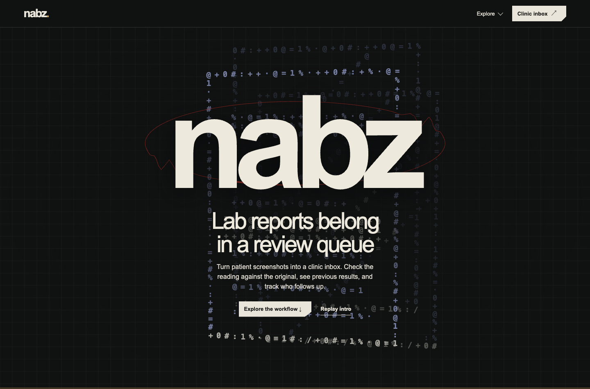
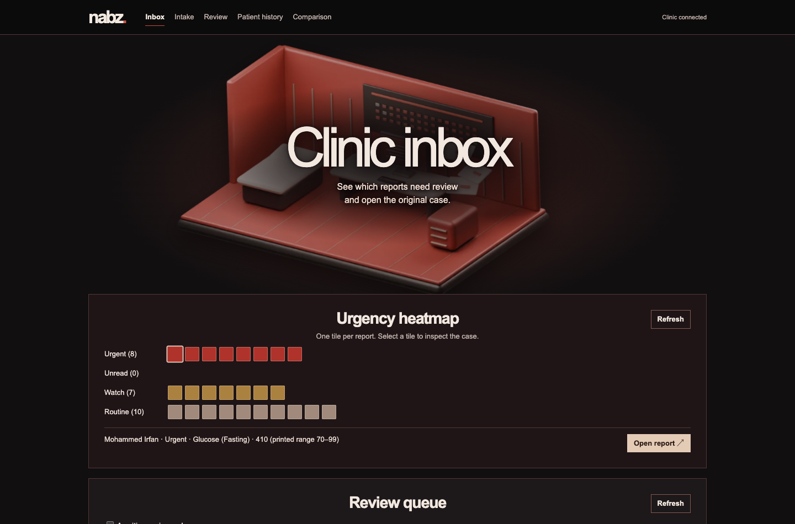
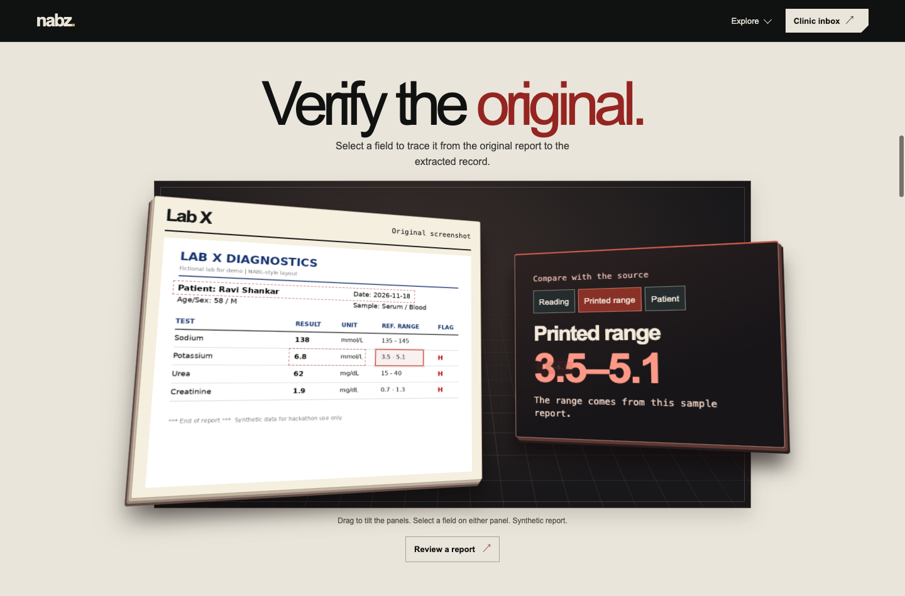
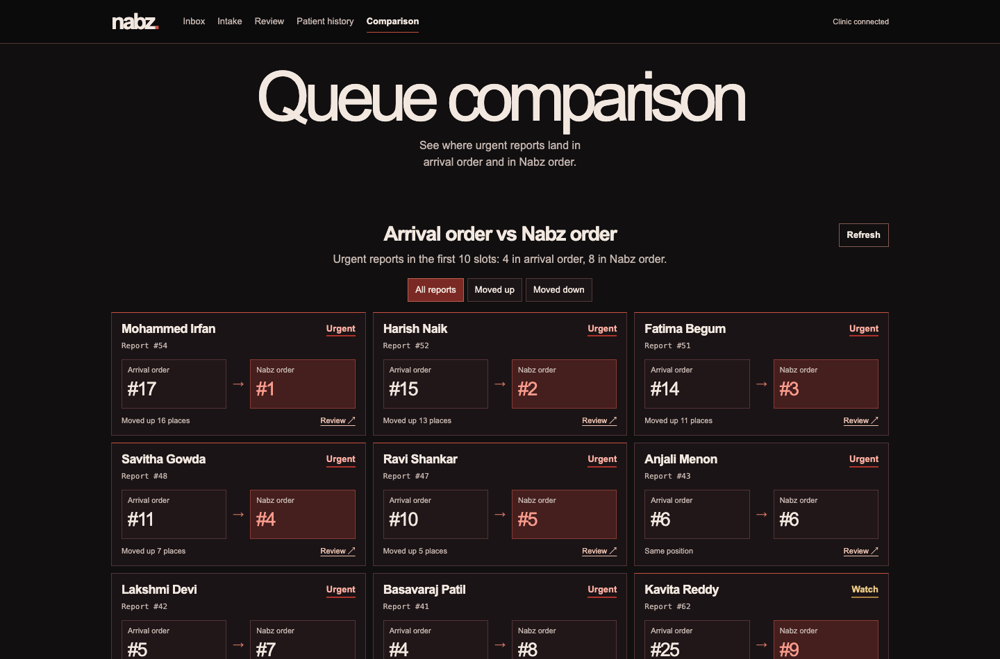

# Nabz · Lab reports, followed through

**First place at the REWIRED 2026 offline hackathon** · Theme B: MIRROR · 19 November 2026

Built by **Team C1CORE** at BMS Institute of Technology and Management, Bengaluru. The team was **Debangshu Banerjee** (captain), **Mayank Prakash**, **Aditya**, and **Prakash**.

	
Live demo	https://nabz-egua.onrender.com (free hosting: the first load after idle can take about a minute)
Demo video (2 min)	add link here
Source	this repository
## UI/UX walkthrough

The prototype screenshots below use synthetic cases.

### Landing

### Clinic inbox

The clinic inbox brings the review queue and urgency heatmap into one workspace.

### Verify the original

Select an extracted field to find it on the source report before confirming the reading.

### Queue comparison

Each card shows how the same report moves from arrival order to review order.

## The problem

In India a patient's lab report usually reaches the doctor as a WhatsApp screenshot or a photo of a screen. A busy clinic gets them all day, and the doctor reads them in the order they arrive. A potassium of 6.8 can sit below a pile of normal reports. There is no record, no trend over time, and the patient's symptom message is a separate chat bubble.

What Nabz does

The screenshot stays the way in, because that is what patients already do. Nabz turns it into something the clinic can act on:

The clinic uploads the screenshot or phone photo (Intake page).
A vision model (Gemini) reads the patient, the date and every test with its printed range, and returns JSON.
Our own rules rank the report as urgent, watch or routine. If the model cannot read it, the report is marked unread and listed right after the urgent ones, so a person always looks.
The doctor sees the original image next to the extracted values and confirms the reading before it is trusted.
Every report is stored per patient, so a rising trend becomes visible (Patient history).

Nabz never diagnoses. It only orders the doctor's queue. The AI reads the picture, and plain, readable rules in rules.py decide the urgency.

Results (simulation on synthetic data)

Test set: 25 synthetic reports in 3 layouts (8 urgent, 4 watch, 10 routine, plus one patient with 3 rising glucose readings), made by our team with an answer key. The model never sees the answer key. Reproduce with python try_all.py.

Check	Result
Patient names read correctly	25 of 25
Test values read correctly	97 of 97
Urgency tier matches the answer key	23 of 25
Urgent reports in the first 10 positions, arrival order	4 of 8 (last urgent at position 17)
Urgent reports in the first 10 positions, Nabz order	8 of 8 (all in the first 8)

About the tier score: the two "misses" are the first two of the trend patient's three reports. The answer key labels all three "trend", but a trend can only be seen once the third reading arrives, so the first two are correctly "watch" when they arrive. The third is flagged as rising.

We also tested one tilted phone photo of a screen (with glare) on the live site, and all 4 values were read correctly. Four more photos are in the test pack but were not run.

This is a simulation on clean synthetic images. It is not clinical evidence. Five chat screenshots with symptom messages are included in test_data/chats/ but are not part of the measured results.

How urgency is decided

All thresholds are in one labelled table in rules.py:

If any value crosses its critical limit, the report is urgent.
Otherwise, if any value is outside the range printed on the report (bounds inclusive), it is watch.
Otherwise it is routine.
A patient message containing "chest pain", "breathless" or "fainted" raises the level one step (supported in the code; the web intake does not collect a message yet).
The same test rising over 3 or more readings, all out of range, marks the patient as rising.
Test	Critical below	Critical above
Potassium	3.0	6.0
Sodium	125	155
Glucose (Fasting)	50	300
Haemoglobin	8	none
Creatinine	none	3.0
Platelets	50	none
Calcium	7.0	none

These limits are our own illustrative assumptions for the demo. They are not clinical guidance and have not been reviewed by a doctor.

Architecture
screenshot / phone photo
        │  POST /api/reports
        ▼
 Flask app (app.py) ──► reader.py ──► Gemini vision API ──► JSON
        │                                                      │
        │              rules.py (our urgency rules) ◄──────────┘
        ▼
 SQLite (db.py): patients, reports, test_results, messages, alerts, settings
        │
        ▼
 static/ website (served by the same Flask app): inbox, intake, review, patient history, comparison

One Flask app serves both the API and the website. If the model call fails or returns bad JSON, the report is stored with status needs_verification (shown as unread) and the app never crashes.

Run it yourself

Needs Python 3.11 or newer and a free Gemini API key from https://aistudio.google.com/apikey.

git clone https://github.com/dab1704/C1CORE-REWIRED-OFFLINE.git
cd C1CORE-REWIRED-OFFLINE
pip install -r requirements.txt

Create a file named .env in the project folder (it is git-ignored):

GEMINI_API_KEY=your_key_here
GEMINI_MODEL=gemini-3.5-flash-lite

Then:

python app.py          # open http://127.0.0.1:5000
python -m unittest     # automated tests, no API calls
python try_all.py      # reads all 25 test reports and prints accuracy (uses the API)

On first start with an empty database, the app loads the demo data from demo_seed.json and demo_uploads/, so the site is never blank. Deployed on Render with gunicorn app:app --timeout 120 --bind 0.0.0.0:$PORT.

API
Route	What it does
POST /api/reports	Upload an image (form field file). Returns {id, level, patient_id, worst, status}
GET /api/inbox	All reports, ranked urgent, unread, watch, routine; newest first within a level
GET /api/reports/<id>/image	The original uploaded image
POST /api/reports/<id>/confirm	The doctor confirms the reading
GET /api/patients	All patients
GET /api/patients/<id>	A patient with all reports, values over time and rising tests
GET /api/compare	Arrival order against Nabz order (the proof panel)
POST /api/reset	Restore the demo data (needs X-Admin-Token when ADMIN_TOKEN is set)
GET /api/health	{"ok": true}
Repository map
Path	Purpose
app.py	Flask routes and report processing
db.py	SQLite tables and helpers
reader.py	Calls Gemini and cleans the JSON it returns
rules.py	Urgency rules and critical limits
demo_seed.py, demo_seed.json, demo_uploads/	Demo data that loads on an empty database
load_demo.py, try_all.py	Load the 25 reports; measure accuracy against the answer key
test_rules.py, test_api.py	Automated tests (22)
static/	The website (landing page, clinic workspace)
test_data/	Synthetic reports, chat screenshots, answer key, declarations
tools/	Small helper scripts used while choosing a model
Team and roles
Member	Role
Debangshu Banerjee (captain)	Product idea, backend, database, urgency rules, model integration, deployment
Mayank Prakash	Frontend: landing page, clinic workspace, review screen, 3D anatomy preview, guide panel
Aditya	Intake channel exploration (a WhatsApp bot prototype that was removed from the submission) and pitch
Prakash	Synthetic test data (25 reports, 5 chat screenshots, 5 phone photos, answer key) and documentation

Git history shows who committed what. The test data was committed to the repository by Debangshu.

AI and tool declaration
Claude (Anthropic): planning, explanations and pitch drafting, used in chat.
Claude Code: wrote most of the backend code from our written prompts. The team reviewed, ran and tested it, and can explain every file.
Gemini API (gemini-3.5-flash-lite): used at run time to read report images. Uploaded report images are sent to Google's API.
AI coding assistance on the frontend.
Image generation: the fictional patient-card portraits on the landing page were generated with an AI image tool and converted to ASCII (see static/nabz/anatomy-attribution.txt).
Development switch: READER_MODE=fake reads test_data/fake_readings.json instead of calling Gemini. It is for development only, off by default, and not used in the demo or on the live site.
The guide panel on the website is a fixed, scripted help panel. It makes no AI calls.
Open-source libraries and assets
Python: Flask, python-dotenv, google-genai, Pillow, requests, gunicorn. Also listed in requirements.txt but not used in the submitted flow: pypdfium2, twilio.
Frontend build: bot-avatars 0.2.2 (MIT, © 2026 Jakub Antalik, see static/nabz/bot-avatar.NOTICE.txt), React and React DOM 19.2.0, esbuild.
3D anatomy preview: geometry derived from Écorché by Charleeh, which adapts Z-Anatomy and BodyParts3D. The adapted geometry is distributed under CC BY-SA 4.0 (full attribution in static/nabz/anatomy-attribution.txt).
Data and safety
All data is synthetic. Every patient name, age, date and value was invented. No real patient data was used anywhere.
"Lab X" is a fictional lab, and its layouts are our own.
Printed reference ranges on the test reports are illustrative.
The urgent, watch and routine labels in test_data/ground_truth.csv are our team's test labels, not medical validation.
The Gemini key lives only in .env and in the host's environment variables. It is not in the repository.
Nabz does not diagnose, advise, or message patients. A doctor confirms every reading.
Limits and what is next
Intake is a web upload of images. WhatsApp intake is the next step; it is not part of this submission.
PDF reports are not supported yet (planned: convert pages to images, then cross-check the text layer).
The model can misread a digit, and that is why the confirm step exists. We measured only clean synthetic images plus one phone photo.
Urgency limits are our assumptions. Next step: use real laboratories' critical-value lists, reviewed by a doctor.
Planned: more languages and layouts, a pilot with a real clinic, and symptom messages attached to reports.